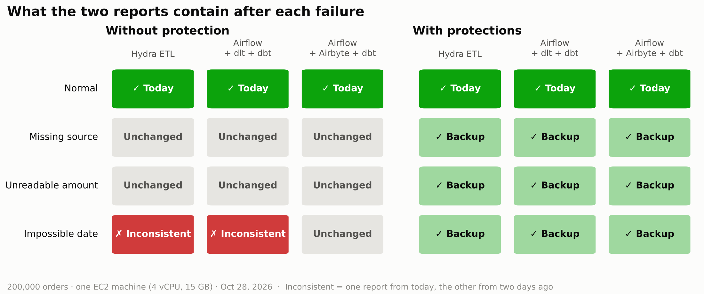
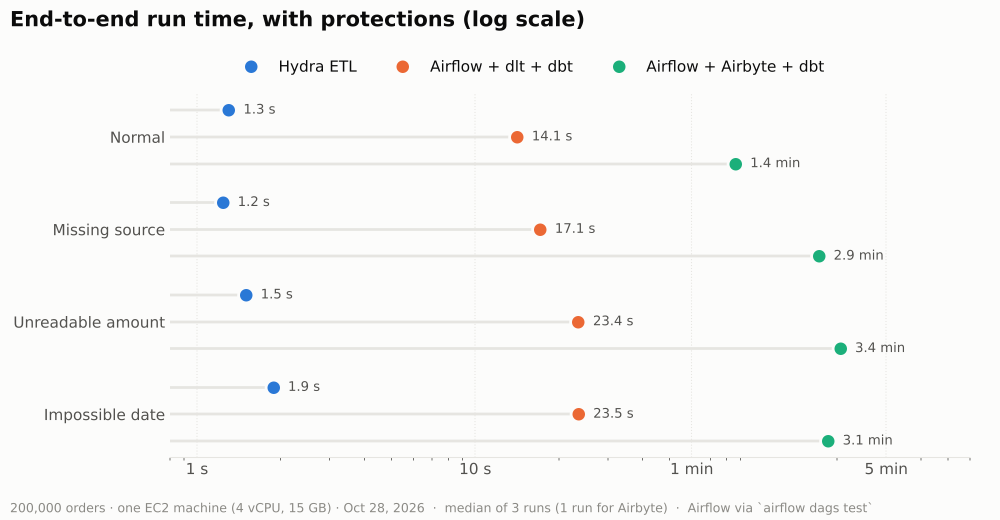
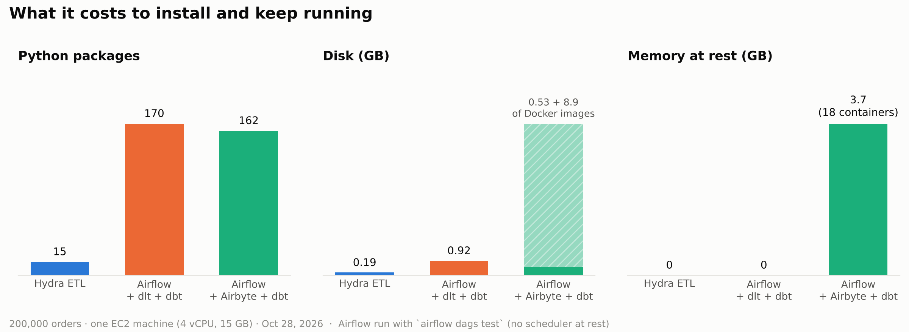
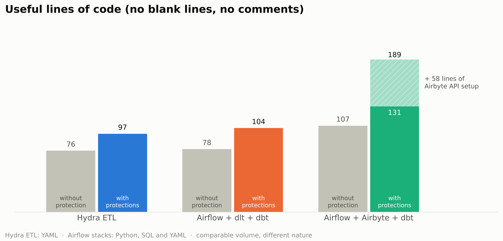

# Hydra ETL vs Airflow + dlt + dbt vs Airflow + Airbyte + dbt

The same small pipeline built three times, with the same four failures injected on purpose. This repository contains everything used for the comparison: the three implementations, the scripts that run and measure them, the raw results and logs, and the script that draws the charts.

Article: *Same guarantees, without programming them* (link added after publication).

## The pipeline

- **Input**: 200,000 orders and 2,000 customers (CSV, generated with a fixed seed by `shared/make_data.py`).
- **Work**: keep paid orders, join customers, compute revenue by country and revenue by month.
- **Output**: `output/revenue_by_country.csv` and `output/revenue_by_month.csv`.
- **Backup**: yesterday's export (`data/backup/orders.csv`, 199,000 orders), to use if today's data is unusable.

Before every run, the outputs hold the day-before-yesterday's reports (198,000 orders). After the run, `shared/scenarios.py` recomputes each expected version with pandas, independently of the stacks, and reports where each output comes from: `main` (today), `backup`, `previous` (unchanged) or `other`.

| Scenario | What breaks |
|---|---|
| `normal` | nothing |
| `missing_source` | `data/orders.csv` is missing |
| `bad_amount` | one amount is `abc`: the first report fails |
| `bad_date` | one date is `2026-13-45`: only the second report fails |
| `crash` (scenario 5) | the run is killed between the two publications, or a reader looks during the run: see below |

Each stack has two variants:

- **simple** (without protection): what you usually write first.
- **safe** (with protections): fallback to the backup when the source is missing or a step fails, both outputs published all-or-nothing, timeouts.

## Results









Raw numbers: `results/phase*/` (`install.json`, `scenarios_simple.json`, `scenarios_safe.json`, `lines_*.txt`), `results/phase3_airflow_airbyte_dbt/extra.json`, `results/machine.json`, `results/metrics.csv` (memory and CPU every second), `results/logs/` (one log per step; Airbyte credentials and private IPs redacted). `results/raw-report.md` is the report generated at the end of the run.

Redraw the charts:

```bash
pip install matplotlib
python charts/make_charts.py results charts
```

## Scenario 5: visibility and hard kill during publication

Added on November 18, 2026 after a comment by Tim Urista on the article: `os.replace` is atomic for one file, but not for the set of reports. A reader can see two generations at once, and a process killed between the two renames leaves a mix on disk. The four scenarios above only check the state after the run has finished, so they cannot see this.

`shared/crash_scenario.py` runs one stack in two modes:

- `observe`: a reader polls both outputs while a normal run publishes them and records every (country, month) pair of versions it sees.
- `kill`: the reader sends `SIGKILL` to the whole run the moment the country report is today's and the month report is still the day-before-yesterday's. It then reports what is left on disk, what the next run does, and the state after the stack's own recovery command.

```bash
# Hydra ETL
python3 shared/crash_scenario.py hydra "hdrctl run ." observe --repeat 5
python3 shared/crash_scenario.py hydra "hdrctl run ." kill --repeat 3 --kill-delay 0.3 --recover "hdrctl workflow undo daily_revenue"
# Airflow + dlt + dbt: kill needs a DAG whose window between the two renames is long enough to hit
python3 shared/make_probe_dag.py 2
python3 shared/crash_scenario.py modern ". ~/bench-envs/modern/bin/activate && . ./env.sh && airflow dags test daily_revenue_safe_probe" kill
```

`--kill-delay` waits that many seconds after the pair is seen: `0` is the earliest possible moment, `0.3` falls during the second step.

`make_probe_dag.py` writes a copy of the safe DAG with a 2 s pause between the two `os.replace` calls. The real window is a few milliseconds; the pause does not change what the code does, it only makes the window possible to hit on purpose.

Results (`results/scenario5_visibility_and_kill/`), measured on November 18, 2026 in a Linux sandbox (Python 3.13, Hydra ETL 0.22.0, Airflow 3.3.2), **not on the EC2 machine of the other results**:

| | Hydra ETL 0.22.0 | Hydra ETL 0.22.0 + write-ahead journal (unreleased patch) | Airflow + dlt + dbt |
|---|---|---|---|
| Reader during a normal run | mixed pair visible about 0.4 s of a 1.5 s run (5 of 5 runs) | same (the patch does not change visibility) | window of a few ms: 1 mixed observation in 3 runs, not conclusive |
| Kill after the first report | mixed state stays on disk | mixed state stays on disk | mixed state stays on disk |
| Next run, kill during step 2 | refuses to start, `hdrctl workflow undo` restores `previous \| previous` | same | overwrites silently, nothing detected |
| Next run, kill just after the rename | **overwrites silently**, orphan `.hydra-bak-*` files left | refuses to start, `hdrctl workflow undo` restores `previous \| previous` | overwrites silently |

What this says, and does not say:

- "All-or-nothing" holds once the run has finished, for all three stacks. It does not hold for a reader that looks while the run publishes, and none of the three stacks closes that on its own. Closing it needs the reader to cooperate: publish each run into its own directory, switch a manifest at the end, and have each reader resolve the manifest once. That is the approach Tim describes; it is not implemented here.
- The Hydra ETL gap found by this test (journal written after the previous file was moved) is fixed by an unreleased patch: the journal is now written before. It covers CSV and Parquet outputs in `replace` mode only; database outputs and `append` mode are unchanged.
- The reader reads the two files one after the other, so a single "mixed" sample a few milliseconds long (as for Airflow) can be a reading artefact. The 0.4 s window of Hydra ETL is not.
- Few runs: five for Hydra's observe test and three for each of its kill tests; three for Airflow's observe test and two for its kill test. Not yet replayed on the EC2 machine, nor on the Airbyte stack.

### Publishing by generation: the recipe Tim describes, measured

Tim's suggestion: write each run into its own directory, switch one manifest file at the end, and have each reader resolve the manifest once. Both stacks got that variant, with the same short helper (`shared/publish_generation.py`: check the generation is complete, switch the manifest, prune): `hydra_gen/` for Hydra ETL (a `python` action as the last step, **no change to the engine**) and `modern/dags/daily_revenue_safe_gen.py` for Airflow. The reader of `crash_scenario.py --manifest` does what a cooperating reader does.

| Same sandbox, same dates | Hydra ETL generation variant | Airflow generation variant |
|---|---|---|
| Reader during a normal run | never a mixed pair (5 runs) | never a mixed pair (2 runs) |
| Kill as soon as the new generation holds its first report | the manifest stays on the previous generation; the reader sees only `previous \| previous` (6 kills) | same (2 kills, with the 2 s pause of `PROBE_PAUSE` between the two copies) |
| What is left on disk | one incomplete generation directory, never named by the manifest | same |
| Next run | refuses to start until `hdrctl workflow undo` (the project keeps `rollback: true` for its fallback) | succeeds |

Reading these results:

- The visibility point is closed for readers that cooperate, in both stacks, by the same recipe. It is a property of the recipe, not of either tool.
- A reader that still opens `output/revenue_by_country.csv` finds nothing at that path any more: this changes the contract with everything downstream.
- Pruning keeps the newest three generations. A reader that holds a generation while three more runs publish could lose its files; not tested.
- Same limits as above: sandbox, few runs, no EC2, no Airbyte stack.

## Layout

| Folder | Content |
|---|---|
| `hydra/`, `hydra_simple/` | Hydra ETL project, safe and simple variants (YAML only) |
| `hydra_gen/` | Hydra ETL project published by generation + manifest (scenario 5; no change to the engine) |
| `modern/` | Airflow DAGs + dlt ingestion + dbt models (DuckDB); `daily_revenue_safe_gen` publishes by generation + manifest (scenario 5) |
| `airbyte/` | Airflow DAGs + Airbyte sync and setup scripts + dbt models (PostgreSQL) |
| `shared/` | data generator, failure scenarios, line counter, report; `crash_scenario.py`, `make_probe_dag.py` and `publish_generation.py` (scenario 5) |
| `run.py` | runs every phase with confirmations, progress and resume points |
| `volume/` | separate volume test (200,000 to 20 million rows, without Airflow) |
| `charts/` | charts and the script that draws them |

Lines are counted by `shared/count_lines.py`: useful lines only, without blank lines or comments.

## Reproduce

On a fresh Ubuntu 24.04 machine (the test used an AWS EC2 instance with 4 vCPUs, 15 GB of RAM and about 60 GB of free disk; Airbyte alone needs about 9 GB of Docker images):

```bash
git clone https://github.com/bejaouibechir/hydra-etl-benchmark.git
cd hydra-etl-benchmark
python3 run.py              # every phase, with a confirmation before each important step
python3 run.py --phase 1    # one phase: 0 setup, 1 Hydra ETL, 2 Airflow + dlt + dbt, 3 Airflow + Airbyte + dbt, 4 report
python3 run.py --status     # where the run stands
```

`run.py` only uses the Python standard library. Each stack is installed in its own virtual environment under `~/bench-envs/`. A failed step can be resumed: `python3 run.py` restarts at the failed step after cleaning it.

To replay only the four failures on Hydra ETL with the latest release:

```bash
python3 -m venv ~/hv && ~/hv/bin/pip install hydra-etl pandas
~/hv/bin/python shared/make_data.py shared/data
~/hv/bin/python shared/scenarios.py hydra "$HOME/hv/bin/hdrctl run ."
```

## Versions and limits

- Measured on October 28, 2026 with Hydra ETL 0.14.0, Airflow 3.3.2 and the dlt, dbt and Airbyte versions current that day (see `results/logs/`). The four failures were replayed with Hydra ETL 0.19.1 on November 5, 2026, with the same results.
- One machine, 200,000 rows.
- Scenario 5 was added later and measured in a sandbox, not on that machine; see its section.
- Three runs per scenario (median), one for Airbyte.
- Airflow runs use `airflow dags test`, which pays Airflow's start-up on every run; in production the scheduler runs continuously.
- Airbyte runs in `--low-resource-mode`, with its file source read over SFTP.
- The volume test in `volume/` ran on a different machine (2 vCPUs, 8 GB) with Hydra ETL 0.14.0, before its DuckDB engine (0.15).
- Code comments and console messages are in French.

Disclosure: the author of this benchmark is the author of Hydra ETL. If you see a flaw in the method, please open an issue.

## License

MIT
